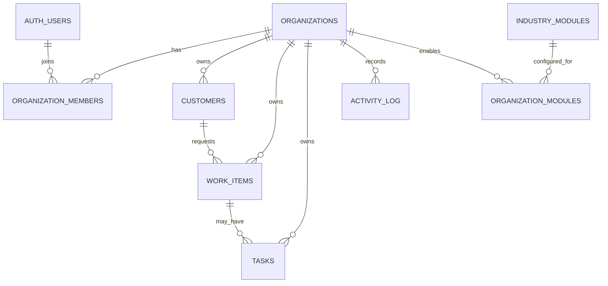

# CRM SaaS — матрица доступа и ER-модель (проект)

Статус: проектирование; не применять к production.

## ER-модель (логическая)

AUTH_USERS означает существующую таблицу пользователей Supabase Auth; не создавать собственную копию паролей или учётных записей.

## Матрица доступа первой версии

| Действие | Owner | Admin | Member |
|---|---:|---:|---:|
| Просмотр записей своей организации | Да | Да | Да, в пределах разрешённого |
| Создание/изменение клиентов | Да | Да | Да, в пределах разрешённого |
| Создание/изменение работ и задач | Да | Да | Да, в пределах разрешённого |
| Удаление бизнес-записей | Да, с защитой/архивацией | Ограниченно | Нет по умолчанию |
| Приглашение и отключение участников | Да | По разрешению | Нет |
| Изменение роли Owner | Только безопасный transfer flow | Нет | Нет |
| Изменение настроек организации | Да | Ограниченно | Нет |
| Просмотр журнала действий | Да | Да | Только относящиеся к доступным записям |
| Доступ к другой организации | Нет | Нет | Нет |

Все «Да» ограничены членством в той же организации и RLS. Роль сама по себе не даёт доступ к чужим данным.

## Базовые правила модели данных

- UUID для первичных ключей.
- `organization_id` NOT NULL на каждой бизнес-таблице; исключения документируются отдельно.
- Внешние ключи по возможности составные с `organization_id`, чтобы нельзя было связать запись организации A с клиентом организации B.
- `created_at` и `updated_at` с серверными значениями времени; actor_id для аудита.
- Архивация вместо безвозвратного удаления для клиентов/работ в первой версии.
- Индексы на `organization_id`, часто используемые фильтры и внешние ключи после проверки запросов.
- Статусы работ сначала задаются конфигурацией организации; не добавлять отдельные столбцы для каждого отраслевого сценария.

## Обязательные тесты изоляции

1. Пользователь A, состоящий только в организации A, видит записи A.
2. Пользователь A не может выбрать записи организации B, даже если знает UUID.
3. Пользователь A не может вставить/обновить строку, указав organization_id организации B.
4. Участник без членства не может читать или менять бизнес-записи.
5. Удалённый/заблокированный участник сразу теряет доступ.
6. Пользователь не может повысить собственную роль или добавить себя в чужую организацию.
7. Попытка привязать work_item организации A к customer организации B отклоняется.
8. Все тесты запускаются в отдельном тестовом проекте, а не на production-данных.

## Перед созданием SQL-миграции

Нужно подтвердить:
- отдельный Supabase project для CRM;
- какие действия Member может делать со всеми работами и какие — только со своими;
- модель приглашения сотрудников;
- правила архивации и экспорта.

После этого можно готовить первую миграцию и автоматические проверки RLS. Не запускать её на production ADAMARKET.
